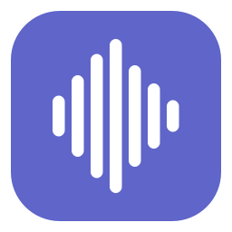
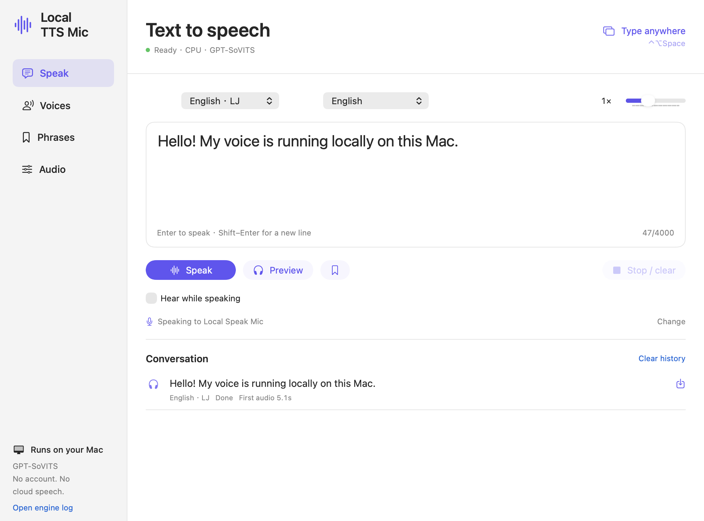

<p align="center">
  
</p>

<h1 align="center">Local TTS Mic</h1>
<p align="center"><strong>Local text-to-speech for calls and games.</strong><br>
A native macOS typing microphone with local GPT-SoVITS speech.</p>
<p align="center">Apple Silicon · macOS 15+ · English / 中文 / 日本語 · MIT app code</p>



Use a floating typing overlay while you’re in a call, playing a game, or keeping a room quiet. Send generated speech to **Local TTS Mic**, or preview it privately in your headphones. After setup, speech generation runs on your Mac without an account, API key, or cloud speech service.

**Installer preview:** [Download the macOS installer](https://github.com/riptideiv/local-tts-mic/releases/tag/v1.2.0). The package is **unsigned and not notarized**, so macOS may block it until you explicitly allow it. See [installation and troubleshooting](docs/INSTALL.md). The screenshot shows a completed private preview in the actual app. Hear a [locally generated English sample](docs/assets/hello.wav) using the public-domain LJ reference; see [demo details](docs/DEMO.md).

## Features

- **Typing overlay:** Control–Option–Space opens the overlay; Enter sends, Shift–Enter adds a line, Escape keeps your draft.
- **Virtual microphone:** select Local TTS Mic in the receiving app. A dedicated Core Audio driver carries speech without changing your system output.
- **Private preview:** Preview sends only to the selected speakers/headphones. “Hear while speaking” adds local monitoring to newly queued microphone messages.
- **Custom voices:** import a clean 3–10 second reference and exact transcript, or a compatible GPT/SoVITS checkpoint pair. No fine-tuning is required to try a reference.
- **Playback controls:** saved phrases, a speech queue, global stop shortcut, and WAV export. Closing the window leaves the menu bar app running.
- **Languages:** English, Mandarin, Japanese, or Auto. English and Mandarin examples install by default. Japanese works with your own reference or an optional JSUT example.

## Installation

### macOS installer

Download `local-tts-mic-1.2.0-arm64-unsigned.pkg` from [Releases](https://github.com/riptideiv/local-tts-mic/releases/tag/v1.2.0). Requires **Apple Silicon and macOS 15 or newer**. This preview is unsigned and not notarized; review [Gatekeeper instructions](docs/INSTALL.md#gatekeeper-and-signatures) before installing.

1. Finish active calls and quit Local TTS Mic. Open the `.pkg` and follow Installer. It installs the app and virtual microphone, asks for administrator authentication, and **briefly restarts all Mac audio**.
2. Open **Local TTS Mic** from Applications. Click **Install / repair** in its setup window to download the models and example voices. Allow **at least 10 GB free** and several GB of internet downloads. No Terminal, Git, Homebrew, or developer tools are needed.
3. Try **Preview**, then select **Local TTS Mic** as the microphone in your call/game app. Keep its output on your usual speakers or headphones.

Models and speech stay on your Mac after setup. Existing voices and settings are retained during upgrades. The preview has local test coverage and an owner-reported successful installation; fresh setup on additional Macs still needs testing. Minimum-RAM behavior is not certified. CPU is the default; MPS is experimental.

### Build from source

Source builds need Command Line Tools with **Swift 6+**, [uv](https://docs.astral.sh/uv/), and [FFmpeg](https://ffmpeg.org/), in addition to the same Mac and storage requirements. Source APIs target macOS 14, but the pinned Python dependency set requires macOS 15 for the packaged build; macOS 14 dependency compatibility is unverified.

Clone the repository, then run:

```sh
git clone https://github.com/riptideiv/local-tts-mic.git
cd local-tts-mic
xcode-select --install    # Skip if Command Line Tools are already installed.
brew install uv ffmpeg   # Requires Homebrew: https://brew.sh
./scripts/setup.sh
./scripts/build.sh
open 'build/Local TTS Mic.app'
```

1. Wait for the engine to show **Ready**.
2. Type a short sentence and click **Preview**. You can try speech without installing a driver.
3. To use calls, finish any active calls, then run `./scripts/install-driver.sh`. The installer asks for administrator access and **briefly restarts all Mac audio**.
4. Choose **Local TTS Mic** as the input in your call/game app. Keep its output on your usual speakers/headphones. Try **Audio → Send test tone** before a call.
5. Use Control–Option–Space to type from anywhere. Control–Option–Escape stops playback and clears the queue. Change shortcuts in **Audio** if they conflict.

`Launch.command` opens the app after it has been built. `./scripts/install.sh` optionally copies it to `~/Applications`. The app uses `runtime/` in this source folder: **keep the folder in place and rebuild after moving it**. It is not a portable `.app` bundle. Builds are ad-hoc signed; see [installation and troubleshooting](docs/INSTALL.md) for Gatekeeper, updating, and uninstalling.

### Japanese example and custom voices

The JSUT reference has personal/non-commercial research restrictions and is **opt-in**:

```sh
./scripts/setup.sh --include-jsut
```

Read the [JSUT terms](https://sites.google.com/site/shinnosuketakamichi/publication/jsut) first. Japanese synthesis can also use your own permitted reference recording. In **Voices → Add voice**, choose a 3–10 second clip, its exact transcript, and reference language. Only import trusted `.ckpt` / `.pth` checkpoint pairs: model loading can execute Python code. Use recordings and voices you have permission to use. See [training](TRAINING.md) and [third-party notices](THIRD_PARTY.md).

### Voice import and catalogue

In **Voices**, use **Import…** for a public Hugging Face URL or downloaded folder, or browse **Catalogue** for pinned community profiles. Imports detect checkpoints and reference metadata, then let you complete missing fields and review the source terms. Checkpoints and references are copied into the app’s library. Imported pairs support **v1, v2, v2Pro, and v2ProPlus**. See [voice import](docs/VOICES.md) for supported formats, v1 setup, storage, and catalogue licensing.

## Privacy and limitations

- Inference runs in a managed Python process over local pipes. Setup and repair contact GitHub, Hugging Face, and upstream resource hosts. Training tools may download additional models.
- Packaged models, speech, and logs stay in `~/Library/Application Support/Local Speak/Managed/runtime/`; source builds use their checkout’s `runtime/`. Voices and preferences stay in `~/Library/Application Support/Local Speak/`. Speech is retained on disk until you delete it. See [privacy](docs/PRIVACY.md).
- Normal speech operation does not capture your physical microphone. Explicit routing diagnostics record the virtual input and can request microphone permission.
- This is sentence-based synthesis, with a delay before first audio. The previous M2 Max validation measured roughly **1–5 seconds to first audio on CPU** for short English/Mandarin/Japanese requests. These are single-machine measurements, not a speed guarantee. [Validation history](VALIDATION.md) records the test conditions.
- CPU is the default. MPS is experimental. No physical-microphone mixing, Windows/Linux UI, auto-updater, or Apple-notarized distribution is included.
- The virtual input has local capture coverage. Transmission through every call app, long sessions, and device-unplug recovery need broader testing. Do not rely on it as your only way to communicate.

## Troubleshooting

```sh
python3 scripts/doctor.py
```

- **Missing driver:** install it, refresh devices, and reopen the receiving app’s input selector.
- **Silent call:** test the input meter and try disabling noise suppression in that app.
- **Silent preview:** check the preview device and volume.
- **Engine error:** use CPU, open the engine log, then try **Audio → Setup / repair runtime**.

See [troubleshooting](docs/INSTALL.md#troubleshooting) for details.

If it still fails, open a bug report with your Mac chip, RAM, macOS version, commit, and whether Preview/test tone work. Remove private text, paths, and voice references from logs first.

## Contributing

The native UI is SwiftUI/AppKit, audio is Core Audio with a small C transport, and speech uses a pinned GPT-SoVITS worker. Model weights and recordings are downloaded locally and excluded from source releases.

Run tests and driver checks without downloading speech models:

```sh
uv venv --python 3.11
uv pip install pytest==8.3.5
./scripts/test.sh
```

CI runs Python boundary/download/cancellation tests, Swift routing/queue tests, the release build, and driver sanitizers. Audio changes also need a real capture test; a “Done” label alone does not prove delivered speech. Read [CONTRIBUTING.md](CONTRIBUTING.md), [the roadmap](docs/ROADMAP.md), and [release notes](CHANGELOG.md).

Areas needing work include testing on additional Apple Silicon Macs, call-app compatibility, setup diagnostics, and signed/notarized distribution. Open an issue before starting a large change.

**License:** app and original driver additions are [MIT](LICENSE). Apple’s driver sample retains its MIT notice. Models, dependencies, and reference recordings have separate terms in [THIRD_PARTY.md](THIRD_PARTY.md).
